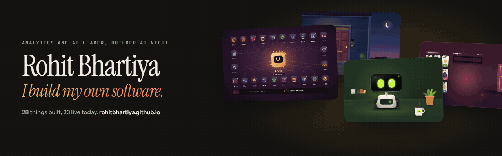
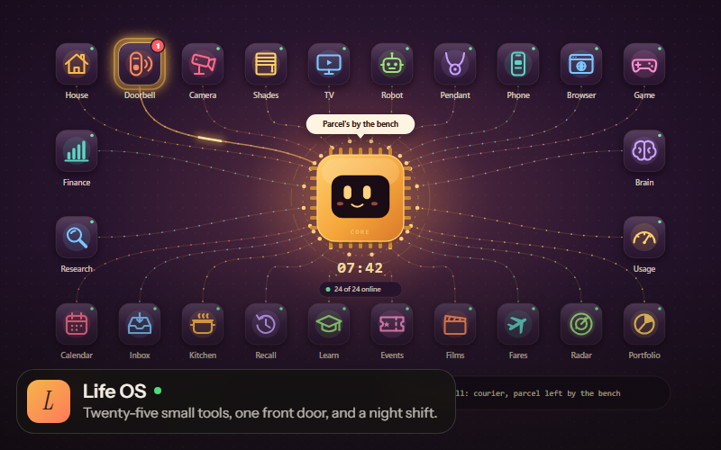
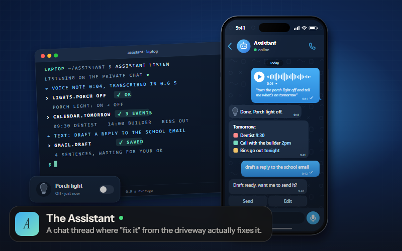
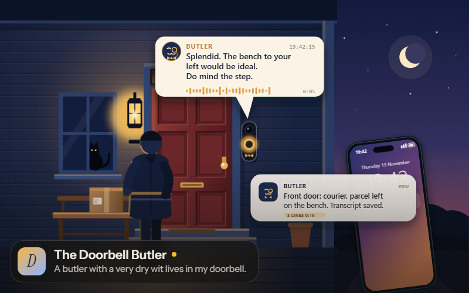
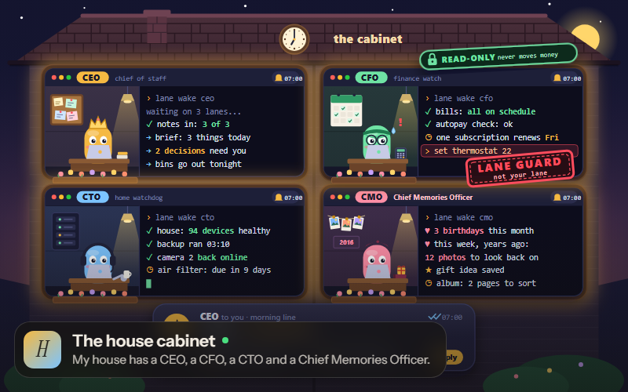
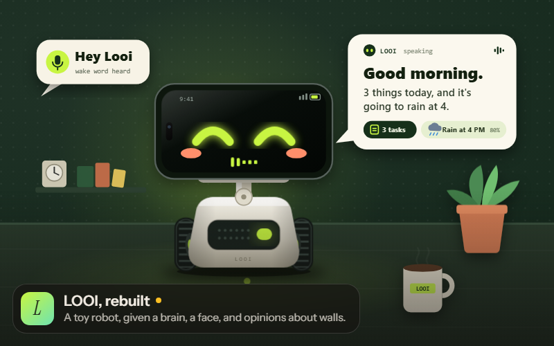
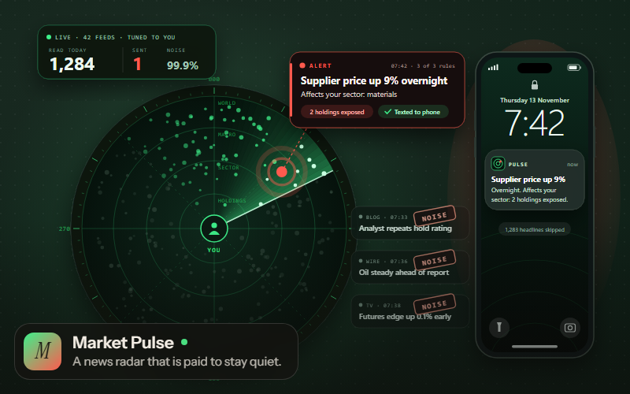
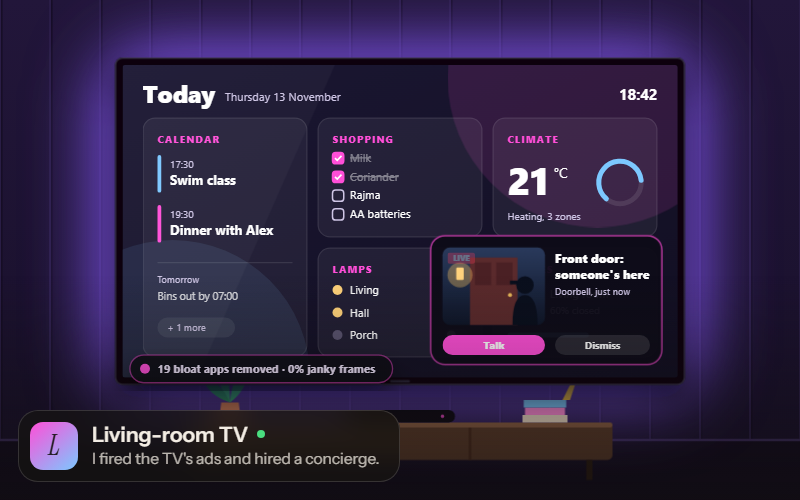

  

  <a href="https://rohitbhartiya.github.io/"><b>The showcase</b></a> &nbsp;·&nbsp; <a href="https://www.linkedin.com/in/rohitbhartiya/"><b>LinkedIn</b></a> &nbsp;·&nbsp; <a href="https://www.rohitbhartiya.com/"><b>Website</b></a>

Analytics and AI leader by day. The rest of the time I build a personal operating system with Claude Code: 25 small tools on a laptop and a Raspberry Pi that run the house, watch the markets, cut films and answer the front door. Every project below has an animated walkthrough on [the showcase](https://rohitbhartiya.github.io/).

## Featured

<table>
<tr>
<td width="50%" valign="top"> <a href="https://rohitbhartiya.github.io/#life-os"><b>Life OS</b></a> <b>736</b> commits in the last three weeks</td>
<td width="50%" valign="top"> <a href="https://rohitbhartiya.github.io/#assistant"><b>The Assistant</b></a> <b>1,100+</b> messages from me in its first 54 days</td>
</tr>
<tr>
<td width="50%" valign="top"> <a href="https://rohitbhartiya.github.io/#doorbell-butler"><b>The Doorbell Butler</b></a> <b>0</b> doors it will open</td>
<td width="50%" valign="top"> <a href="https://rohitbhartiya.github.io/#house-cabinet"><b>The house cabinet</b></a> <b>0</b> money moved by the CFO, by design</td>
</tr>
<tr>
<td width="50%" valign="top"> <a href="https://rohitbhartiya.github.io/#looi"><b>LOOI, rebuilt</b></a> <b>1 day</b> from first commit to talking and driving</td>
<td width="50%" valign="top"> <a href="https://rohitbhartiya.github.io/#market-pulse"><b>Market Pulse</b></a> <b>2</b> news pushes a day, max (it used to send 7)</td>
</tr>
<tr>
<td width="50%" valign="top"> <a href="https://rohitbhartiya.github.io/#tv"><b>Living-room TV</b></a> <b>19</b> ad and bloat apps switched off</td>
<td width="50%"></td>
</tr>
</table>

## Everything else

**The platform**

- [The Brain](https://rohitbhartiya.github.io/#brain): Checks on everything hourly. Mostly decides to say nothing.
- [Chief of Staff](https://rohitbhartiya.github.io/#cos): Does my homework at 3 a.m. and briefs me at 6:50.
- [Brain mode](https://rohitbhartiya.github.io/#brain-mode): The boss that is not allowed to touch the keyboard.
- [Auto-merge and self-deploy](https://rohitbhartiya.github.io/#ships): Ready means it ships. Then the laptop updates itself.
- [The phone connector](https://rohitbhartiya.github.io/#lifeos-inbox): A door with one key and no hands.
- [Usage dashboard](https://rohitbhartiya.github.io/#usage-dash): I built a fuel gauge for my AI.

**The house**

- [Home and Jarvis](https://rohitbhartiya.github.io/#home): A house that runs itself and tattles when something dies.
- [Camera AI](https://rohitbhartiya.github.io/#camera-ai): Every "person at the door" alert gets a second opinion.
- [Reverse-engineered shades](https://rohitbhartiya.github.io/#shades): I taught a tiny radio to speak my window shades' language.
- [Kitchen](https://rohitbhartiya.github.io/#kitchen): It doesn't plan dinner. It reminds you to soak the rajma.

**The intelligence layer**

- [Discovery](https://rohitbhartiya.github.io/#discovery): A scout that only reports finds it can put to work.
- [Research desk](https://rohitbhartiya.github.io/#research): A research desk with a cost dial and an in-house skeptic.
- [Recall](https://rohitbhartiya.github.io/#recall): A memory that cites its sources and admits when it has none.
- [Portfolio watcher](https://rohitbhartiya.github.io/#portfolio): An analyst that can read every number and press no buttons.
- [Fare finder](https://rohitbhartiya.github.io/#fares): I taught my laptop to haggle with airlines.
- [Learn](https://rohitbhartiya.github.io/#learn): A tutor that argues back. Currently waiting for its student.

**For the fun of it**

- [Tribute](https://rohitbhartiya.github.io/#tribute): Dozens of family phone clips in, one properly cut birthday film out.
- [Events](https://rohitbhartiya.github.io/#events): Finds the good nights out before the tickets get expensive.
- [CrispCo: Snack Wars](https://rohitbhartiya.github.io/#crispco): Run a snack company, fight a bigger rival, try not to get fired.

---

Every picture here is an illustration with invented data, because the real screens show a real family's life. Built with Claude Code. Everything here runs on machines I own: a laptop, a Raspberry Pi, and a lot of stubbornness.
